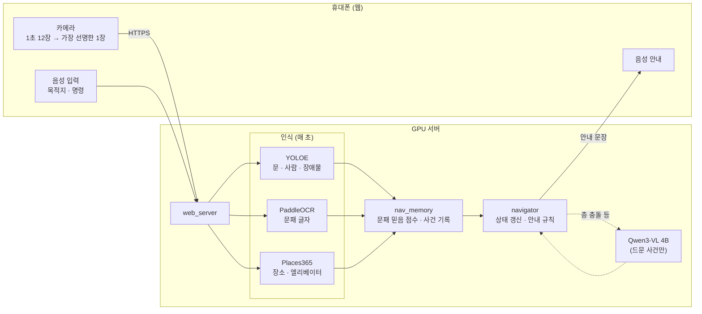

<div align="center">

# VLM_NAV

**시각장애인을 위한 제로샷 실내 길안내**

휴대폰 카메라 한 대로 건물 안 목적지 호실까지 음성으로 안내합니다.<br>
지도나 사전 학습 없이, 문패·엘리베이터·복도 같은 단서를 실시간으로 읽어 길을 찾습니다.


</div>

---

## 개요

VLM_NAV는 처음 방문한 건물에서도 시각장애인이 목적지 호실을 찾아갈 수 있도록 돕는 실내 길안내 시스템입니다. 사용자는 휴대폰을 앞으로 든 채 걷기만 하면 되고, 시스템은 1초마다 장면을 분석해 지금 위치와 다음 행동을 음성으로 알려 줍니다.

- **제로샷**: 건물 지도, 호실 목록, 건물별 학습 데이터를 쓰지 않습니다.
- **빠른 인식 + 드문 추론**: 매 초의 판단은 가벼운 인식 모델과 규칙이 맡고, 무거운 VLM은 드물게 생기는 애매한 상황에서만 부릅니다.
- **시간 순서 기억**: 한 장면이 아니라 걸어오며 본 문패와 장소를 누적해 판단합니다.

## 주요 기능

| 기능 | 설명 |
|---|---|
| 음성 목적지 입력 | "317호"처럼 말하면 확인 질문 후 바로 안내를 시작합니다. 화면 두 번 누르기로도 확정할 수 있습니다. |
| 시작 위치 파악 | 처음 5초 동안 주변을 살펴 층과 장소를 먼저 알려 준 뒤 다음 행동을 안내합니다. |
| 문패 기반 길찾기 | 읽은 호실 번호로 층을 판단하고, 번호가 목적지에 가까워지는지로 진행 방향을 안내합니다. |
| 엘리베이터 안내 | 장소 인식으로 엘리베이터 문을 찾으면 "타고 4층을 누르세요"처럼 바로 안내합니다. |
| 오독 걸러내기 | 문패마다 믿음 점수를 쌓아(반복 인식, 글자 크기, 문 옆 위치, 주변 번호와의 일관성) 안내도·표지 숫자 같은 잘못된 번호를 걸러냅니다. |
| 도착 안내 | 목적지 문패가 보이면 남은 거리와 방향을 알리고, 문 앞에서 도착을 알립니다. |
| 꾸준한 안내 | 새 정보가 없어도 10초마다 진행 상황을 짧게 알립니다. |

## 시스템 구성



**1초 처리 흐름**

1. 휴대폰이 0.25초마다 3장을 찍어 가장 선명한 장을 고르고, 1초치 중 가장 선명한 1장을 서버로 보냅니다. 판단이 애매하면 다음 1초는 4장을 모두 보냅니다.
2. 서버는 YOLOE(물체), PaddleOCR(글자), Places365(장소)를 실행합니다.
3. 읽은 호실 번호는 기억(`nav_memory`)에 쌓이고, 믿음 점수가 기준을 넘으면 확정됩니다.
4. 규칙이 확정된 문패, 층, 장소 흐름을 보고 안내 문장을 만듭니다.
5. 휴대폰이 문장을 음성으로 읽습니다.

## 현재 성능

> 한 건물(대학 강의동)의 영상 3개와 휴대폰 시연 기록으로 잰 내부 시험 결과입니다. 다른 건물에서의 일반화는 아직 검증하지 않았습니다.

**판단 지점 17개에서 다음 행동 정확도**

| 방식 | 정확 | 비고 |
|---|---|---|
| 규칙 (현재 서비스) | **15 / 17** | 처리 시간 0초 |
| Gemini 3.5 Flash (관찰 기록만 입력) | 14 / 17 | 외부 API |
| Qwen3 14B (서버, 생각 모드) | 8 / 17 | 응답 33초 |
| Qwen3-VL 4B · Gemma3 12B · Qwen2.5-VL 7B (서버) | 0 ~ 5 / 17 | |

**인식과 처리 시간**

| 항목 | 결과 |
|---|---|
| 문 인식 (3층 복도) | 기준 90개 중 75개 탐지, 정밀도 82% |
| 문패 번호 오독 걸러내기 (시연 126걸음) | 잘못된 번호 14종 → 1종, 진짜 문패 10개 중 9개 유지 |
| 전송량 (1초 4장 → 선명한 1장) | 1,444 KB → 392 KB (73% 감소) |
| 서버 처리 (1초 기준) | 사진 1장 0.6초, 4장 1.4초 |

자세한 측정 과정은 [`docs/`](docs/README.md)에 정리되어 있습니다.

## 저장소 구조

```
VLM_NAV/
├── src/
│   ├── nav/        길안내 서비스 (웹 서버, 인식, 기억, 안내 규칙)
│   ├── tools/      시연 기록 재실행, GPU 잠금
│   └── eval/       텍스트 모델 추론 평가
├── docs/           실험 기록과 결과 정리
├── data/video/     시험 영상 정답표와 실험 결과
└── review/         사진 1장 파이프라인 채점 기준 (10월)
```

모듈별 설명은 [`src/README.md`](src/README.md)를 참고하세요.

## 시작하기

### 요구 사항

| 구분 | 내용 |
|---|---|
| 서버 | NVIDIA GPU (Tesla P100 16GB에서 확인), Python 3.12 |
| 라이브러리 | `ultralytics` 8.4, `paddleocr` 3.7, `paddlepaddle` 3.3, `torch` 2.14, `torchvision` 0.29, `opencv-python`, `pillow`, `requests` |
| 모델 | YOLOE `yoloe-11l-seg.pt`, Places365 ResNet18, PaddleOCR PP-OCRv5 (한국어) |
| VLM | Ollama + `qwen3-vl:4b-instruct` |
| 실행 PC (Mac) | `cloudflared` (휴대폰용 https 주소) |

모델 파일은 저장소에 포함되어 있지 않습니다. 서버는 `models/`, Mac은 저장소 최상위의 `local_models/`에 두면 자동으로 찾습니다.

### 실행

```bash
# 1. 서버에 SSH 연결 (한 번)
ssh -o ControlMaster=yes -o ControlPath=/tmp/kyj-cnu.sock -o ControlPersist=12h -fN cnu

# 2. 웹 켜기: 서버 웹 실행 → Mac 포트 연결 → 휴대폰용 https 주소 출력
bash src/nav/web_mac.sh start

# 3. 휴대폰에서 주소를 열고 "말하기"를 눌러 목적지를 말하거나, 목적지를 입력한 뒤 "안내 시작"

# 4. 끝내기 (GPU 반납)
bash src/nav/web_mac.sh stop
```

녹화 영상으로 실행하려면 서버에서 다음을 실행합니다.

```bash
cd src/nav
python navigator.py --mode situ --frames <frames_8fps 폴더> --out-dir <결과 폴더> \
  --route "314=1_start_졸프_영상3,2b_after_elevator_졸프_영상2"
```

## 문서

| 문서 | 내용 |
|---|---|
| [핵심 정리](docs/13_2026-10-29_핵심정리.md) | 10월까지의 결론 |
| [객체인식 수준](docs/14_2026-11-08_객체인식_수준_3층4층_비교.md) | YOLOE · OCR · VLM 비교 |
| [참고 논문](docs/15_2026-11-16_참고논문_FollowTheSigns_WalkVLM-LR.md) | Follow the Signs, WalkVLM-LR와 설계 방향 |
| [보관한 실험 목록](docs/16_2026-11-17_보관한_실험_목록.md) | 지난 실험과 다시 꺼내는 법 |
| [전체 목차](docs/README.md) | 모든 문서 |

## 한계와 향후 과제

- **일반화**: 한 건물에서만 시험했습니다. 다른 건물 영상으로 검증이 필요합니다.
- **전송 지연**: 휴대폰 → 서버 왕복이 한 걸음 간격의 대부분을 차지합니다.
- **추론 모델**: 서버에서 돌릴 수 있는 모델은 다음 행동을 직접 고르기 어렵습니다. 모델에는 번호 규칙 같은 좁은 가설만 맡기는 구조를 시험할 예정입니다.
- **미구현**: 장애물 경고, 엘리베이터 안 버튼 찾기, 층별 안내도 활용.

## 참고

- Cao et al., *Follow the Signs: Using Textual Cues and LLMs to Guide Efficient Robot Navigation*, arXiv:2601.06652, 2026.
- *Less Redundancy: Boosting Practicality of Vision Language Model in Walking Assistants*, arXiv:2508.16070, 2025.
- Zhou et al., *Places: A 10 Million Image Database for Scene Recognition*, TPAMI 2017.
